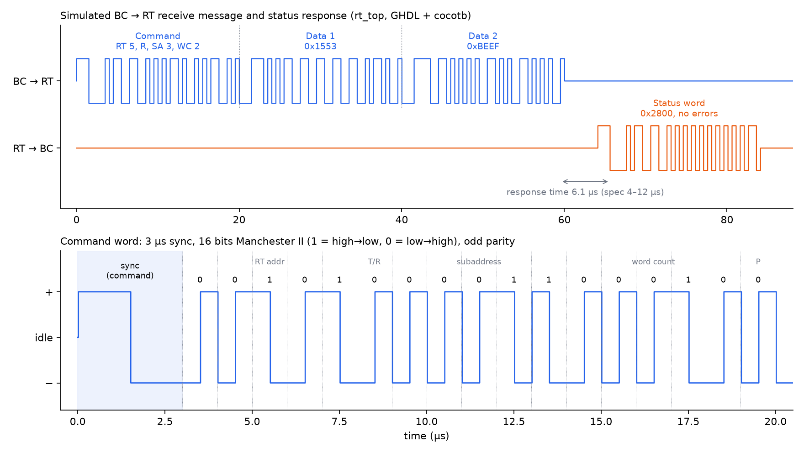
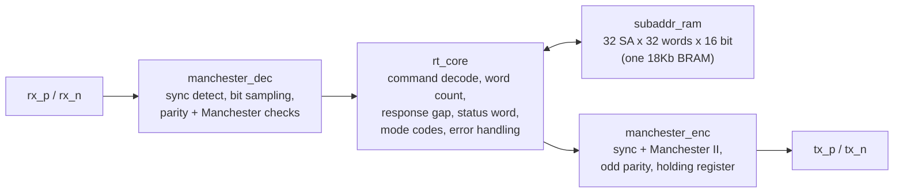

# MIL-STD-1553B Remote Terminal (VHDL)

[](https://github.com/alberto-hdz/mil1553-rt/actions/workflows/tests.yml)


[](LICENSE)

MIL-STD-1553B is the command/response data bus used in military aircraft avionics: a bus controller (BC) sends commands at 1 Mbps and remote terminals (RTs) answer with a status word and data. This repo is my VHDL implementation of a 1553B **remote terminal**, verified with a Python/cocotb bus controller model and implemented on a Xilinx Artix-7.

## Highlights

- **Full RT message handling**: receive and transmit messages (1–32 words), broadcast, three mode codes, status word, and every error case the standard requires the RT to detect
- **23 self-checking cocotb tests**, including ±100 ns jitter, ±150 ns edge displacement, ±0.1% bit-rate error, and 40 randomized messages checked against a Python RAM model
- **Mutation-tested**: deliberately injected bugs are caught by the test suite
- **Implemented on Artix-7 at 100 MHz**: 197 LUTs, 255 flip-flops, 1 RAMB18, +4.5 ns setup slack
- **CI on every push** with GitHub Actions



*Waveform captured from simulation of `rt_top` (regenerate it with `make waveform`). Top: the BC sends a receive command and two data words, and the RT answers with its status word 6.1 µs later. Bottom: the command word, bit by bit.*

## Architecture



The bus pins are two-wire (positive / negative / both low = idle), matching the logic side of a 1553 transceiver.

| Module | What it does |
|---|---|
| `manchester_enc` | Builds the 40 half-bit pattern (3 µs sync, 16 data bits, odd parity) and shifts it out at 1 Mbps. A one-word holding register keeps consecutive words contiguous. |
| `manchester_dec` | Two-flop synchronizer, run-length sync detection, half-bit sampling timed from the mid-sync edge, parity and Manchester error flags. |
| `rt_core` | RT protocol state machine. |
| `subaddr_ram` | Receive/transmit data buffer. |
| `rt_top` | Top level. Generics: `RT_ADDR` (0–30), `CLKS_PER_HALF` (25 at 50 MHz, 50 at 100 MHz). |

## Repository layout

```
rtl/            VHDL source (VHDL-2008)
model/          bit-true Python reference model of 1553 words
tb/cocotb/      cocotb testbenches and the bus controller model (bc.py)
syn/            Vivado build script, constraints, and post-route reports
tools/          CI result checker and waveform plotter
docs/           figures
```

## Quick start

Requirements: GHDL and Python 3.

```bash
python3 -m venv .venv && source .venv/bin/activate
pip install -r requirements.txt
make test
```

`make help` lists every target. A full test run takes a few minutes.

## Supported

- BC→RT (receive) and RT→BC (transmit) messages, word count 1–32 (WC = 0 means 32)
- Broadcast receive (RT address 31): data stored, no response, Broadcast Command Received bit set
- Status word with Message Error and Broadcast Command Received bits
- Mode codes: Transmit Status Word (00010), Reset Remote Terminal (01000), Transmit Last Command (10010). Other mode codes get a status word with Message Error set.
- Error handling: parity error, Manchester error, too few words, too many words, gap inside a message, wrong sync type. On any of these the RT sets Message Error and does not respond, as the standard requires.
- Superseding command: a new valid command cuts off an unfinished message.
- Response time: about 6.1 µs (spec: 4–12 µs, measured mid-parity to mid-sync).

## Not supported

- RT-to-RT transfers
- Broadcast mode codes
- Dual-redundant bus (A/B)
- Double buffering: receive data is written to RAM as it arrives, so a message that fails partway still leaves its earlier words in RAM
- Real transceiver / transformer-coupled bus (logic-level only)

## Verification

All testbenches are cocotb (Python) running on GHDL. Every run uses a new random seed.

| Testbench | Tests | Coverage |
|---|---|---|
| `test_enc.py` | 2 | 200 random words decoded by the reference model; back-to-back words with no gap |
| `test_dec.py` | 8 | About 3,400 words per run decoded bit-exact across: ideal timing, ±100 ns random jitter on every edge, one edge per word moved ±150 ns, bus rate ±0.1%, parity error, Manchester error, idle-bus noise |
| `test_rt.py` | 13 | Every feature above plus 40 random read/write messages checked against a Python model of the subaddress RAM. Every response is checked for the 4–12 µs response time. |

**Mutation checks**: I broke the design on purpose to confirm the tests catch it.

| Bug injected | Caught by |
|---|---|
| Even parity instead of odd in the encoder | `test_random_words`: bad parity on the first word |
| Sync threshold lowered from 1.25 µs to 0.75 µs | `test_idle_noise`: 12 false words decoded from noise |
| Response gap cut from 4 µs to 1 µs | `test_receive_then_transmit`: response time 3.1 µs, below the 4 µs minimum |

cocotb's `make` returns success even when a test fails, so `tools/check_results.py` reads each results file and fails the build on any failing test.

## FPGA implementation

Vivado 2024.2, Artix-7 `xc7a200tfbg484-1`, 100 MHz clock (`CLKS_PER_HALF = 50`), post-route:

| Resource | Used |
|---|---|
| Slice LUTs | 197 |
| Slice registers | 255 |
| Block RAM | 1 RAMB18 (0.5 tile) |
| DSP48 | 0 |

| Timing | Result |
|---|---|
| WNS (setup) | +4.539 ns (critical path about 5.5 ns) |
| WHS (hold) | +0.059 ns |
| Failing endpoints | 0 of 544 |

The bus inputs are asynchronous to the system clock, so they go through two-flop synchronizers marked `ASYNC_REG` and are false-pathed in `syn/rt_top.xdc`. Full reports are in `syn/reports/`.

To rebuild, run this from `syn/`: `vivado -mode batch -source build.tcl`

## Design notes

- **Sync detection.** The longest constant level inside a valid word is 1.0 µs (a 1 followed by a 0). A sync half is 1.5 µs, so a run of at least 1.25 µs followed by a polarity flip marks the middle of a sync. The upper limit is 2.5 µs because a data sync can merge with the last half of the previous word's parity bit.
- **Timing recovery.** Each word is timed from its own mid-sync edge. A 0.1% rate error over one 20 µs word is only 20 ns, well inside the 250 ns sampling margin, so re-timing on every bit is not needed.
- **Contiguous words.** Integration testing showed my first encoder left a one-clock idle gap between words. I added a one-word holding register so the next word starts the same clock the previous one ends, and added `test_back_to_back` to keep it fixed.
- **Too many words.** The RT knows how many words to expect. If the bus is still active 0.5 µs into the response gap, the BC is still sending, so the RT sets Message Error and stays silent.

## License

[MIT](LICENSE)
